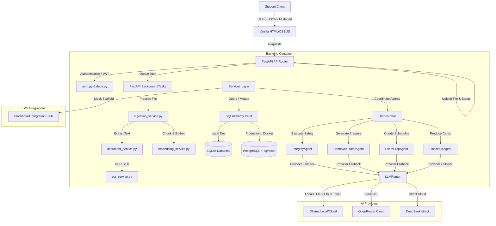
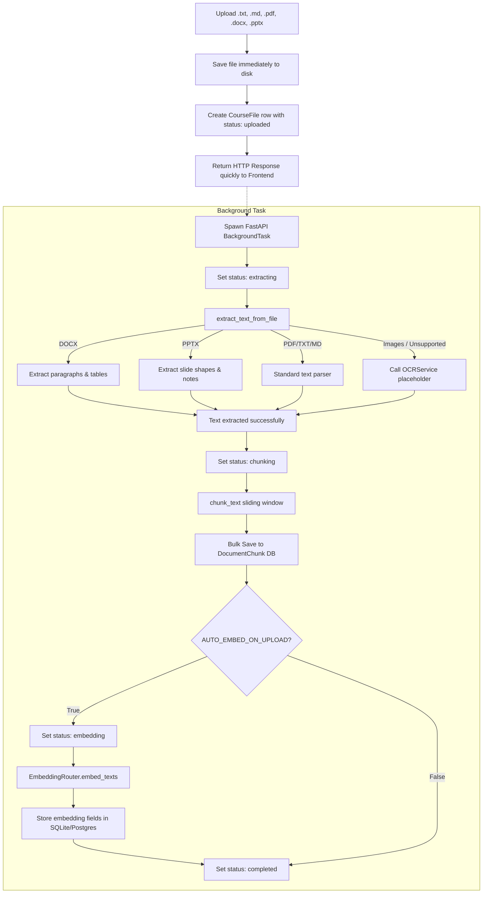
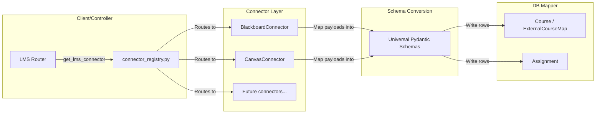
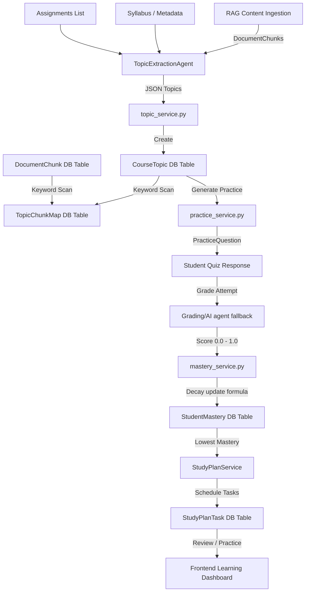
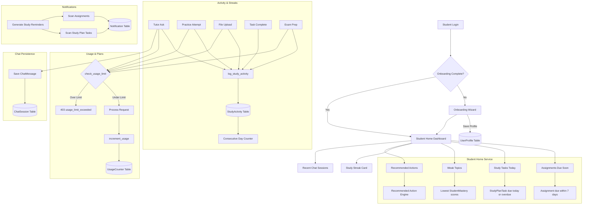

# Architectural Overview - NaySchool 3.0

This document outlines the architectural patterns, interfaces, and future additions of the NaySchool 3.0 educational operating system.

---

## System Design Diagram

---

## 1. Background Document Ingestion & Embedding Pipeline

### Ingestion Flow Details:
1. **Frontend Non-Blocking Experience**: When a document is uploaded via `/api/courses/{course_id}/upload`, it is written to the course directory `backend/storage/uploads/{course_id}/`. The API instantly creates a `CourseFile` record with statuses initialized to `uploaded`, `pending`, `pending` and returns a `200 OK` status URL to the frontend.
2. **FastAPI BackgroundTasks**: A background worker coordinates text extraction, chunking, and embeddings.
3. **Advanced Formats**: 
   - **DOCX**: Extracted using `python-docx` for paragraphs and table formatting.
   - **PPTX**: Extracted using `python-pptx` slides shapes and slide note annotations.
   - **OCR (Scanned PDFs, Images)**: Directed to `OCRService` raising `NotImplementedError` for future optical character recognition pipeline integration.
4. **Chunking & Storage**: Text is split into overlapping chunks, saved to `DocumentChunk` table, and optionally embedded automatically on upload.

---

## 2. Ingestion Status Monitoring & Reprocessing

- **Polling Endpoints**: Frontend polls `/api/courses/{course_id}/files/{file_id}/status` to refresh processing stages (`uploaded` $\rightarrow$ `extracting` $\rightarrow$ `chunking` $\rightarrow$ `embedding` $\rightarrow$ `completed`/`failed`).
- **Ingestion Summary**: Route `/api/courses/{course_id}/ingestion-status` compiles metrics across the entire course file list.
- **Reprocessing**: Calling `POST /api/courses/{course_id}/files/{file_id}/reprocess` resets state flags, purges existing chunks, and spawns the background worker tasks again.

---

## 3. Database Scaffolding (SQLite to PostgreSQL Transition)

- **SQLite Auto-migration**: SQLite tables are auto-created during development, including automatic startup scripts executing `ALTER TABLE` to append status columns seamlessly.
- **Alembic migrations**: Alembic is initialized with environments resolving database connections dynamically via `Settings.DATABASE_URL` (reads env variables). Ready for PostgreSQL migrations.
- **Docker Compose pgvector**: Prepares Postgres with pgvector plugin under port `5432` alongside Adminer UI panel dashboard on port `8080`.

---

## 4. Universal LMS Connector Architecture

To scale integration compatibility, NaySchool 3.0 uses a decoupled, universal LMS connector architecture. Rather than building features directly around provider-specific payloads, the connector package isolates them:

### Components:
- **Base Interface (`BaseLMSConnector`)**: Defines standardized abstract async workflows for OAuth link creation, credentials exchange, token refresh, and syncing courses, grades, content, and assignments.
- **Provider Models (`LMSCourse`, `LMSAssignment`, etc.)**: Pydantic models acting as data boundaries. LMS responses are transformed into these unified entities before DB operations.
- **Connection Security**: LMS credentials are saved in the `LMSConnection` table. Secrets (access and refresh tokens) are encrypted on write and decrypted on read using the symmetric Fernet wrapper.
- **Database Mappings**:
  - `ExternalCourseMap` maps provider external IDs to internal `Course` rows.
  - `Assignment` columns (`external_provider`, `external_id`, `external_course_id`) map Blackboard/Canvas tasks to internal objects, avoiding sync duplication.
  - `LMSSyncLog` captures audit reports for institutional safety reviews.

---

## 5. Student Learning System (Phase 5)

Phase 5 introduces a comprehensive mastery-based student learning system, moving NaySchool from a course-aware chat platform to an educational operating system.

### Components:
- **Topic Extraction Flow**:
  - Pulls text from syllabus files, first 30 text chunks, and assignment titles.
  - Sends context to `TopicExtractionAgent` to return clean topic names, descriptions, and confidence levels.
  - Automatically falls back to a regex title-case and header pattern matching keyword extractor if LLM provider fails.
- **Topic Chunk Mapping**:
  - Runs case-insensitive substring and word-boundary regex checks against all ingested document chunks.
  - Stores matches in `TopicChunkMap` with calculated term frequency relevance scores.
- **Practice, Grading, and Mastery Update Loop**:
  - Generates questions on-demand via `PracticeQuestionAgent` referencing relevant chunks mapped to the topic.
  - Grades student answers asynchronously comparing correctness against expected answer keys.
  - Mastery update decay formula:
    $$new\_mastery = old\_mastery \times 0.75 + score \times 0.25$$
    $$confidence = \min(1.0, attempts\_count / 10)$$
- **Weakness-Driven Study Task Scheduling**:
  - Analyzes the mastery dashboard and identifies the top 3 weakest topics (mastery score $< 0.85$).
  - Auto-schedules study plan tasks (conceptual reviews, reading, chat tutor questions, quizzes) distributed across the next N days.
  - Lower mastery scores result in higher urgency priority levels.

---

## 6. Student Productization Architecture (Phase 6A)

Phase 6A transforms NaySchool from a backend-heavy MVP into a student-friendly daily learning product.

### Components:

- **Onboarding & User Profile**:
  - `UserProfile` stores education level, major, school name, study goal, preferred study style, and daily study minutes.
  - The onboarding wizard (`POST /api/me/onboarding/complete`) captures preferences in a guided multi-step flow and sets `onboarding_completed = true`.
  - Profile is auto-created on first `GET /api/me/profile` if missing.

- **Student Home Service** (`student_home_service.py`):
  - `get_assignments_due_soon()` — Queries assignments across all user courses that are not completed and due within the next 7 days.
  - `get_study_tasks_today()` — Returns pending/in-progress `StudyPlanTask` entries due today or overdue.
  - `get_weak_topics_across_courses()` — Finds the 5 lowest mastery scores across all courses.
  - `get_recommended_actions()` — Generates contextual next-step suggestions per course (upload material → extract topics → generate practice → strengthen weak areas → create exam prep).
  - `get_student_home()` — Aggregates all above data plus user info, profile, courses count, recent courses, recent chat sessions, and streak into a single dashboard payload.

- **Activity & Streak Service** (`activity_service.py`):
  - `log_study_activity()` — Records a `StudyActivity` row with type (`tutor_question`, `practice_attempt`, `study_task_completed`, `file_uploaded`, `exam_prep_generated`) and optional JSON metadata.
  - `get_study_streak()` — Counts consecutive calendar days (ending today or yesterday) with at least one activity. Returns `current_streak_days`, `active_today`, and `last_activity_at`.
  - `get_recent_activity()` — Returns the most recent N activity entries for the activity feed.

- **Usage & Plan Service** (`usage_service.py`):
  - Three-tier plan system: **Free**, **Plus**, **Pro** with monthly usage limits.
  - `UsageCounter` tracks per-month counts for tutor questions, uploads, practice generations, and exam prep generations.
  - `check_usage_limit()` — Compares current usage against the user's plan limits before allowing an action.
  - `increment_usage()` — Bumps the relevant counter after a successful action.
  - Plan limits (monthly): Free = 50 tutor / 5 uploads / 10 practice / 3 exam prep; Plus = 500 / 50 / 100 / 20; Pro = 2000 / 200 / 500 / 100.
  - `PATCH /api/me/plan-dev` is a testing-only endpoint; real billing integration (Stripe) is deferred.

- **Chat Session Persistence**:
  - `ChatSession` and `ChatMessage` models store full tutor conversation history per course.
  - CRUD routes allow listing, creating, viewing (with message history), and deleting sessions.
  - The `POST /api/courses/{course_id}/tutor/ask` endpoint accepts an optional `session_id` to continue a conversation; if omitted, a new session is created automatically.
  - Chat titles are derived from the first user question.

- **Notification Service**:
  - `Notification` model stores in-app notifications typed as `assignment`, `study_task`, `exam`, or `system`.
  - `POST /api/courses/{course_id}/notifications/generate-study-reminders` scans upcoming assignments and study tasks to auto-create notifications (with deduplication).
  - `PATCH /api/notifications/{id}/read` marks a notification as read.
  - Email and push notification delivery are deferred to a future phase.

---

## 7. Future Additions (Phase 6B / 7)
- **Phase 6B**: Instructor dashboard, LTI 1.3 tool provider compliance, admin metrics panel, Stripe payment integration, email/push notification delivery.
- **Phase 7**: Full OAuth REST integration on live Blackboard/Canvas sandboxes, pgvector native SQL vector queries, Celery + Redis task queues, cloud OCR (AWS Textract / Google Vision / Tesseract), mobile native shell.

